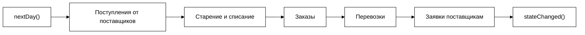

# Система управления оптовым складом

Практикум, выполненный на **C++ с использованием фреймворка Qt**.
Приложение моделирует работу оптового склада, который обслуживает несколько торговых точек: принимает заказы, формирует перевозки, заказывает товар у поставщиков, уценивает, списывает товары с истекающим сроком годности и показывает итоговую статистику.

**Авторы:** *Хамидулин Тимофей Юрьевич* ; *Паненко Денис*

---

## Содержание

1. [Введение](#1-введение)
2. [Постановка задачи](#2-постановка-задачи)
3. [Термины](#3-термины)
4. [Быстрый старт](#4-быстрый-старт)
5. [Руководство пользователя](#5-руководство-пользователя)
6. [Типовые сценарии работы](#6-типовые-сценарии-работы)
7. [Математическая модель](#7-математическая-модель)
8. [Архитектура программы](#8-архитектура-программы)
9. [Бэкенд (логика склада)](#9-бэкенд-логика-склада)
10. [Тестирование](#10-тестирование)
11. [Вопросы и проблемы](#11-вопросы-и-проблемы)
12. [Выводы](#12-выводы)

---

## 1. Введение

Программа предназначена для **заведующего складом**. Она помогает ему видеть, что происходит на складе каждый день, и принимать решения:

- какие перевозки в торговые точки утвердить
- какие заявки отправить фирмам-поставщикам
- на сколько процентов уценить товары, у которых скоро закончится срок годности

Поток заказов и поставок **моделируется**: программа сама «проживает» каждый день (от 10 до 30 дней), случайным образом создаёт заказы торговых точек, а пользователь управляет процессом и принимает решения

---

## 2. Постановка задачи

Оптовый склад хранит **K видов** продуктовых товаров (12 ≤ K ≤ 20) и обслуживает **M торговых точек** (3 ≤ M ≤ 9) — мелких магазинов и палаток. Основные условия:

- **Вместимость склада ограничена**: каждого вида товара можно хранить не более заданного числа оптовых упаковок.
- У всех товаров есть **срок годности**. Если он истекает через несколько дней, товар **уценивается**, чтобы продать его быстрее. После истечения срока товар **списывается** и вывозится со склада.
- Склад знает, сколько чего лежит, срок годности и стоимость каждого товара.
- Каждый день от каждой торговой точки поступает **не более одного заказа** (заказ включает список товаров и их количество).
- Товар отпускается только **оптовыми упаковками**, поэтому выданное количество может немного отличаться от заказанного (чуть больше или чуть меньше). Если товара не хватает, заказ выполняется **частично**.
- Когда какого-то товара остаётся мало, формируется **заявка фирме-поставщику**. Поставка приходит через случайное число дней от 1 до 5.
- Заведующий складом **просматривает и утверждает** список перевозок на следующий день, список заявок поставщикам и список товаров к уценке. Процент уценки он выбирает сам.
- Для проверки системы моделируется поток заказов и поставок. Период моделирования занимает **N дней** (10 ≤ N ≤ 30).
- В ходе моделирования доступна информация о наличии товаров, заказах за день, перевозках на завтра, вывозе просроченных товаров и денежных потерях. По окончании выводится итоговая статистика.
### Как это реализовано

| Требование ТЗ | Где в программе |
|---|---|
| Параметры N, M, K, начальный набор товаров, диапазоны случайных величин | Окно «Параметры…» |
| Наличие товаров, сроки годности, цены | Вкладка «Склад» |
| Заказы за текущий день | Вкладка «Заказы за день» |
| Перевозки на следующий день, утверждение | Вкладка «Перевозки на завтра» |
| Заявки поставщикам, утверждение | Вкладка «Заявки поставщикам» |
| Уценка и выбор процента уценки | Вкладка «Уценка» |
| Вывоз просроченных товаров, денежные потери | Вкладка «Списание и потери» |
| Статистика за весь период | Вкладка «Итоги» |
| Шаг моделирования — один день | Кнопки «Следующий день» и «Запустить до конца» |

---

## 3. Термины

| Термин                | Что это значит                                                                                                                           |
| --------------------- | ---------------------------------------------------------------------------------------------------------------------------------------- |
| **Оптовая упаковка**  | Единица, в которой склад отпускает товар. Например, одна упаковка риса = 20 пачек по 1 кг. Продать «полупачки» или «пол-упаковки» нельзя |
| **Единица товара**    | Пачка, килограмм и т. п. — то, что считается внутри упаковки                                                                             |
| **Торговая точка**    | Магазин или палатка, которая заказывает товар на складе. В программе обозначается «Точка 1», «Точка 2» и т. д.                           |
| **Заказ**             | Список товаров и их количества (в единицах), который торговая точка присылает на склад. Не более одного заказа в день от точки           |
| **Перевозка**         | Доставка выданных по заказу товаров в торговую точку на следующий рабочий день. Каждая перевозка формируется из одного заказа            |
| **Заявка поставщику** | Просьба к фирме-поставщику привезти на склад определённое число упаковок товара, которого стало мало                                     |
| **Уценка**            | Снижение цены товара в процентах. Нужна, чтобы быстрее продать товар с подходящим к концу сроком годности                                |
| **Списание**          | Вывоз со склада товара, у которого срок годности истёк. Склад теряет деньги                                                              |
| **Утверждение**       | Решение заведующего склада «да, делаем» для перевозки или заявки                                                                         |
| **Моделирование**     | Имитация работы склада в течение N дней с шагом в один день                                                                              |

---

## 4. Быстрый старт

Это самый короткий путь «от запуска до результата»

1. **Запустите программу.** Открывается главное окно. Кнопки «Следующий день» и «Запустить до конца» серые: моделирование ещё не начато.
2. **Нажмите «Параметры…».** Откроется окно с параметрами. Для первого запуска ничего менять не нужно, просто нажмите **OK**.
3. Моделирование запущено, кнопки стали активными. В левом верхнем углу написано «День: 0 / 10».
4. **Нажмите «Следующий день» 2–3 раза.** Склад моделирует дни: появляются заказы, перевозки, заявки поставщикам.
5. Перейдите на вкладку **«Перевозки на завтра»**, выберите перевозку в верхней таблице и нажмите **«Утвердить выбранную перевозку»**.
6. Перейдите на вкладку **«Уценка»**, выберите товар, задайте процент и нажмите **«Применить уценку»**.
7. Нажмите **«Запустить до конца»**. Моделирование дойдёт до последнего дня, и откроется вкладка **«Итоги»** с общей статистикой.

Чтобы провести моделирование заново с теми же или другими параметрами, снова нажмите «Параметры…» и **OK**.

---

## 5. Руководство пользователя

### 5.1. Главное окно

В верхней части окна находится **панель управления**, под ней — **вкладки**.

| Элемент | Что делает |
|---|---|
| **День: X / N** | Показывает, сколько дней моделирования прошло (X) и сколько всего их будет (N). Если моделирование не запущено, показывает «День: 0» |
| **Параметры…** | Открывает окно настроек. После нажатия **OK** в нём моделирование **начинается заново** с нулевого дня |
| **Следующий день** | Проходит ровно один день: товары стареют, поступают заказы, формируются перевозки и заявки. Серая, пока моделирование не запущено или уже завершено |
| **Запустить до конца** | Автоматически проходит все оставшиеся дни подряд и открывает вкладку «Итоги». Серая в тех же случаях, что и предыдущая |

**Вкладки:**

1. Склад
2. Заказы за день
3. Перевозки на завтра
4. Заявки поставщикам
5. Уценка
6. Списание и потери
7. Итоги

Все вкладки **обновляются автоматически** после каждого дня и после каждого вашего решения.

Во всех таблицах можно выбирать строку щелчком мыши. Редактировать ячейки напрямую нельзя (кроме таблицы начальных товаров в окне параметров). Размер колонок подстраивается под ширину окна, окно можно растягивать.

---

### 5.2. Окно «Параметры моделирования»

Открывается кнопкой **«Параметры…»**. Здесь задаётся всё, что нужно для запуска моделирования.

#### Общие параметры

| Поле                              | Допустимые значения | Значение по умолчанию | Смысл                                                                                             |
| --------------------------------- | ------------------- | --------------------- | ------------------------------------------------------------------------------------------------- |
| **Дней моделирования (N)**        | 10 – 30             | 10                    | Сколько дней будет длиться моделирование                                                          |
| **Торговых точек (M)**            | 3 – 9               | 3                     | Сколько магазинов и палаток обслуживает склад                                                     |
| **Видов товаров (K)**             | 12 – 20             | 12                    | Сколько разных товаров хранится на складе. **Определяет число строк в таблице начального набора** |
| **Позиций в заказе, от / до**     | 1 – 20              | 1 / 4                 | Сколько разных товаров может быть в одном заказе (случайное число в этом диапазоне)               |
| **Количество в позиции, от / до** | 1 – 10000           | 20 / 200              | Сколько единиц одного товара заказывает торговая точка (случайное число в этом диапазоне)         |
| **Срок поставки (дней), от / до** | 1 – 5               | 1 / 5                 | Через сколько дней поставщик привезёт товар по заявке (случайное число в этом диапазоне)          |

#### Начальный набор товаров

Под общими параметрами находится таблица **«Начальный набор товаров на складе»**. Это то, что лежит на складе в день 0. **Число строк в ней всегда равно K.** Если изменить K:

- при увеличении в конец таблицы добавятся новые строки с товарами по умолчанию;
- при уменьшении лишние строки с конца пропадут (их данные будут потеряны).

В таблице **редактируются все ячейки**:

| Колонка                  | Допустимые значения             | Смысл                                     |
| ------------------------ | ------------------------------- | ----------------------------------------- |
| **Название**             | любой непустой уникальный текст | Название товара                           |
| **Упаковок на складе**   | 0 – 100000                      | Сколько упаковок лежит на складе в начале |
| **Макс. упаковок**       | 1 – 100000                      | Вместимость склада по этому товару        |
| **Единиц в упаковке**    | 1 – 100000                      | Сколько пачек (кг) в одной упаковке       |
| **Единица (кг, пачек…)** | любой непустой текст            | В чём измеряется товар                    |
| **Цена упаковки**        | 0,01 – 10 000 000               | Цена одной упаковки без уценки            |
| **Дней до конца срока**  | 1 – 365                         | Сколько дней товар ещё годен              |

Чтобы изменить число, щёлкните по ячейке и введите значение либо используйте стрелки в ячейке. Текст (название, единицу) редактируйте двойным щелчком.

#### Кнопки OK и Cancel

- **OK** — проверяет данные, сохраняет параметры и **запускает моделирование заново**. Все данные предыдущего моделирования сбрасываются.
- **Cancel** — закрывает окно без изменений.

#### Какие ошибки может показать программа

При нажатии **OK** выполняется проверка. Если что-то неверно, появится окно с предупреждением, и окно параметров останется открытым.

| Сообщение | Причина | Что делать |
|---|---|---|
| «В диапазонах значение „от“ не может быть больше значения „до“» | Например, позиций в заказе «от» 5 и «до» 2 | Поправьте границы диапазона |
| «Строка N: не заполнено название товара» | Пустое название у товара в строке N | Впишите название |
| «Строка N: название „…“ уже встречалось выше» | Два товара с одним названием | Дайте товарам разные названия |
| «Строка N: не заполнена единица измерения» | Пустая колонка «Единица» | Впишите, например, «пачек» или «кг» |
| «Строка N: упаковок на складе больше, чем вместимость склада» | В колонке «Упаковок на складе» значение больше, чем «Макс. упаковок» | Уменьшите остаток или увеличьте вместимость |

Строка с проблемой выделяется в таблице автоматически.

---

### 5.3. Вкладка «Склад»

Показывает **все товары, которые сейчас лежат на складе**. Это главный экран: обычно по нему начинают день.

| Колонка | Что означает |
|---|---|
| **Товар** | Название товара |
| **Упаковок (есть / макс.)** | Сколько упаковок на складе сейчас и какова вместимость склада по этому товару. Запись «30 / 60» читается так: лежит 30 упаковок из максимально возможных 60 |
| **В упаковке** | Сколько единиц в одной упаковке, например «20 пачек» |
| **Цена упаковки** | Цена одной упаковки **без учёта уценки**, в денежных единицах |
| **Дней до конца срока** | Сколько дней товар ещё можно продавать. Если станет меньше нуля, товар будет списан |
| **Уценка** | Текущий процент уценки. «0 %» означает, что уценки нет |

**Подсветка.** Строки товаров, у которых **до конца срока годности осталось не больше N дней**, закрашиваются **оранжевым**. Это сигнал: «этот товар скоро испортится, подумайте об уценке». Число N (порог) задаётся **на вкладке «Уценка»** и по умолчанию равно 5.

После каждого нового дня данные обновляются: уменьшаются остатки (из-за выданных заказов), уменьшается срок годности (на один день), поступает товар от поставщиков.

---

### 5.4. Вкладка «Заказы за день»

Показывает **все заказы торговых точек, поступившие за текущий день** и то, как склад их выполнил. Вкладка только для просмотра.

Каждая строка — это **одна позиция** заказа (один товар). Если в заказе три товара, будет три строки с одинаковым номером заказа.

| Колонка | Что означает |
|---|---|
| **Заказ №** | Номер заказа |
| **Торговая точка** | Кто сделал заказ («Точка 1», «Точка 2» …) |
| **Товар** | Название заказанного товара |
| **Заказано (ед.)** | Сколько **единиц** (пачек, кг) запросила торговая точка |
| **Выдано упаковок** | Сколько целых упаковок склад выделил |
| **Выдано (ед.)** | Сколько это единиц. Может немного **отличаться** от заказанного, ведь товар отпускается упаковками |
| **Стоимость** | Сколько стоит выданное (с учётом уценки, если она действует) |

**Почему «выдано» не равно «заказано».** Склад не вскрывает упаковки. Например, точка заказала 100 пачек, а в упаковке по 12 пачек. Ближайшее целое число упаковок — 8 (96 пачек) — и склад выдаст 96. Если на складе меньше упаковок, чем нужно, заказ выполняется **частично**, и в колонке «Выдано (ед.)» будет меньше, чем в «Заказано (ед.)».

Если за день заказов не было (так тоже бывает, не каждая точка заказывает каждый день), таблица будет пустой.

---

### 5.5. Вкладка «Перевозки на завтра»

Здесь заведующий складом **утверждает перевозки**. Каждая перевозка формируется из одного заказа и отправляется в торговую точку **на следующий рабочий день**.

Вкладка состоит из двух таблиц и кнопки.

**Верхняя таблица — список перевозок:**

| Колонка | Что означает |
|---|---|
| **Перевозка №** | Номер перевозки (совпадает с номером заказа) |
| **Торговая точка** | Куда везём |
| **Позиций** | Сколько разных товаров в перевозке |
| **Сумма** | Общая стоимость перевозки |
| **Статус** | «Ожидает утверждения» или «Утверждена» |

**Нижняя таблица — состав выбранной перевозки.** Появляется, когда вы выбрали строку сверху:

| Колонка | Что означает |
|---|---|
| **Товар** | Название |
| **Заказано (ед.)** | Что просила точка |
| **Выдано упаковок** | Сколько упаковок положено в перевозку |
| **Выдано (ед.)** | Сколько единиц в этих упаковках |
| **Стоимость** | Стоимость этой позиции |

**Как утвердить перевозку:**

1. Щёлкните по строке перевозки в верхней таблице. Внизу откроется её состав.
2. Проверьте состав и сумму.
3. Нажмите **«Утвердить выбранную перевозку»** (справа внизу).
4. Статус сменится на «Утверждена», а строка станет **зелёной**.

Кнопка **активна только когда** выбрана строка и перевозка ещё не утверждена. Если кнопка серая, значит, либо ничего не выбрано, либо перевозка уже утверждена. Выбор строки **сохраняется** при переходе на следующий день, пока перевозка существует.

---

### 5.6. Вкладка «Заявки поставщикам»

Когда какого-то товара на складе остаётся мало, система формирует **заявку фирме-поставщику**: сколько упаковок привезти. Заведующий складом просматривает заявки и **утверждает** их.

| Колонка | Что означает |
|---|---|
| **Заявка №** | Номер заявки |
| **Товар** | Какой товар заказываем у поставщика |
| **Заказать упаковок** | Сколько упаковок просим привезти |
| **Срок поставки (дней)** | Через сколько дней товар приедет на склад (случайное число от 1 до 5, диапазон задаётся в параметрах) |
| **Статус** | «Ожидает утверждения» или «Утверждена» |

**Как утвердить заявку:**

1. Щёлкните по заявке в таблице.
2. Нажмите **«Утвердить выбранную заявку»**.
3. Статус сменится на «Утверждена», строка станет **зелёной**.

Кнопка, как и на вкладке перевозок, активна только для выбранной и ещё не утверждённой заявки.

Пока заявка не доставлена, повторная заявка на тот же товар не создаётся.

---
### 5.7. Вкладка «Уценка»

Здесь заведующий склада **сам решает, на сколько процентов уценить** товары, у которых подходит к концу срок годности.

Вкладка состоит из трёх частей.

**1. Фильтр по сроку годности (сверху).**
Поле **«Показывать товары, у которых осталось не больше (дней)»** — число от 1 до 30, по умолчанию 5. Это **порог**: в таблице ниже будут только те товары, у которых до конца срока годности осталось не больше указанного числа дней.

Этот же порог управляет **оранжевой подсветкой на вкладке «Склад»**: если вы поставите порог 10, на складе оранжевым подсветятся все товары со сроком годности 10 дней и меньше.

**2. Таблица товаров под уценку.**

| Колонка | Что означает |
|---|---|
| **Товар** | Название |
| **Упаковок на складе** | Сколько осталось |
| **Дней до конца срока** | Сколько ещё можно продавать |
| **Цена упаковки** | Цена без уценки |
| **Уценка** | Текущий процент уценки |
| **Цена с уценкой** | Сколько упаковка стоит с учётом уценки |

Если в таблице пусто, значит, нет товаров, подходящих под порог. Увеличьте число дней в фильтре.

**3. Редактор уценки (внизу).**

- **«Процент уценки для выбранного товара»** — число от 0 до 90 %. Активно только тогда, когда в таблице выбран товар. При выборе в поле подставляется текущая уценка этого товара.
- **«Применить уценку»** — применяет выбранный процент.

**Как уценить товар:**

1. При необходимости измените порог дней вверху.
2. Щёлкните по товару в таблице.
3. Задайте процент уценки в поле (например, 25 %).
4. Нажмите **«Применить уценку»**.
5. В таблице обновятся колонки «Уценка» и «Цена с уценкой», а на вкладке «Склад» изменится колонка «Уценка».

Чтобы **снять уценку**, поставьте 0 % и нажмите «Применить уценку».

**Зачем уценять.** Согласно условиям моделирования, торговые точки охотнее заказывают уценённый товар, причём **чем больше процент уценки, тем выше вероятность заказа**. Но уценка уменьшает выручку склада и увеличивает его потери. Смысл решения в том, чтобы найти баланс: продать товар до конца срока и не потерять слишком много денег. Сколько вы потеряли на уценке, видно на вкладке «Списание и потери».

---

### 5.8. Вкладка «Списание и потери»

Показывает, **какие товары пришлось выбросить** из-за истёкшего срока годности и **сколько денег склад из-за этого потерял**.

**Таблица «Просроченные товары, вывезенные со склада»:**

| Колонка | Что означает |
|---|---|
| **Товар** | Что списано |
| **Списано упаковок** | Сколько упаковок было вывезено |
| **Потери от списания** | Сколько денег потеряно на этом списании |

В таблице накапливаются **все** списания за период моделирования.

**Сводные строки под таблицей:**

| Строка | Что означает |
|---|---|
| **Всего списано упаковок** | Общее число списанных упаковок за весь период |
| **Потери от списания** | Общая денежная сумма, потерянная из-за списаний |
| **Потери от уценки** | Сколько склад недополучил из-за того, что продавал товар со скидкой |
| **Общие потери** | Сумма двух предыдущих потерь |

Вкладка помогает оценить свои решения: если списывается много товара, значит, уценку нужно было делать раньше или сильнее. Если же потери от уценки слишком велики, возможно, скидки были избыточными.

---

### 5.9. Вкладка «Итоги»

Содержит **итоговую статистику за период моделирования**.

Сверху написан статус:

| Надпись | Когда показывается |
|---|---|
| «Моделирование не запущено» | До нажатия «OK» в окне параметров |
| «Моделирование идёт. Промежуточные итоги:» | Пока не пройдены все N дней |
| «Моделирование завершено. Итоги за весь период:» | После последнего дня |

Показатели:

| Показатель | Что означает |
|---|---|
| **Продано (единиц товара)** | Общее число проданных единиц (пачек, кг) за всё время |
| **Выручка от продаж** | Сколько денег получил склад (с учётом уценок) |
| **Потери от уценки** | Недополученные деньги из-за скидок |
| **Потери от списания** | Деньги, потерянные на просроченном товаре |
| **Общие потери** | Сумма потерь от уценки и от списания |
| **Списано упаковок** | Сколько упаковок пришлось вывезти как просроченные |

Эта вкладка **открывается автоматически**, когда моделирование заканчивается — после последнего дня или после нажатия «Запустить до конца». Пока моделирование идёт, на ней можно смотреть промежуточные итоги.

---

## 6. Типовые сценарии работы

### 6.1. Ежедневный цикл заведующего складом

Если вы идёте по моделированию по одному дню, то каждый день удобно делать так:

1. Нажмите **«Следующий день»**.
2. Откройте **«Склад»**. Нет ли оранжевых строк (товары с подходящим сроком годности)?
3. Если есть, перейдите на **«Уценка»** и назначьте процент.
4. Откройте **«Заказы за день»** и посмотрите, что заказали точки.
5. Откройте **«Перевозки на завтра»** и **утвердите** все перевозки.
6. Откройте **«Заявки поставщикам»** и **утвердите** новые заявки.
7. Повторите.

### 6.2. Быстрое моделирование для сравнения стратегий

Если нужно сравнить, как влияет уценка на результат:

1. Запустите моделирование (**Параметры → OK**) и нажмите **«Запустить до конца»**, не делая никакой уценки. Запишите общие потери с вкладки «Итоги».
2. Снова нажмите **Параметры → OK** (с теми же параметрами) и проходите день за днём, уценивая товары на сроке 3–5 дней на 20–30 %.
3. Сравните итоговые потери и выручку.

Так как заказы моделируются случайно, результаты двух запусков будут отличаться, и надёжный вывод можно сделать, только повторив эксперимент несколько раз.

### 6.3. Запуск с особыми условиями

В окне параметров можно создать «стресс-тест»:

- поставьте **M = 9** торговых точек и большие количества в заказах (например, от 100 до 500): склад будет быстро пустеть, и появится много заявок поставщикам;
- поставьте **маленькое «упаковок на складе»** у нескольких товаров: сразу появятся заявки;
- поставьте **«Дней до конца срока» = 1–2** у части товаров: увидите, как работает списание.

---

## 7. Математическая модель

В этом разделе описаны формулы, по которым считаются суммы и потери. Обозначения:

| Символ | Значение |
|---|---|
| $p$ | цена одной упаковки без уценки |
| $d$ | процент уценки (число от 0 до 90) |
| $u$ | число единиц товара в одной упаковке |
| $q$ | заказанное количество (в единицах) |
| $s$ | остаток товара на складе (в упаковках) |
| $s_{\max}$ | вместимость склада по этому товару (в упаковках) |
| $s_{\text{ож}}$ | число упаковок по заявкам, которые ещё не доставлены |
| $k$ | число выданных упаковок |
| $e$ | число дней до конца срока годности |
| $t$ | порог на вкладке «Уценка» (в днях) |

### 7.1. Цена упаковки с уценкой

$$
p' = p \cdot \left(1 - \frac{d}{100}\right)
$$

Пример: упаковка риса стоит $p = 1500$, уценка $d = 20\%$, значит, $p' = 1500 \cdot 0{,}8 = 1200$.

### 7.2. Сколько упаковок выдать по заказу

Торговая точка заказывает $q$ единиц товара. Склад выдаёт целое число упаковок, ближайшее к $q / u$, но не меньше одной и не больше имеющегося остатка:

$$
k = \min\Bigl(s,\; \max\bigl(1,\; \text{round}(q / u)\bigr)\Bigr)
$$

Выданное количество единиц и отклонение от заказа:

$$
n = k \cdot u, \qquad \Delta = n - q
$$

Если $\Delta > 0$, выдано чуть больше заказанного. Если $\Delta < 0$, чуть меньше (в том числе когда товара на складе не хватает и заказ выполнен частично).

Пример: $q = 100$, $u = 12$, $s = 40$. Тогда $q/u \approx 8{,}33$, округляем до $8$, $k = 8$, $n = 96$, $\Delta = -4$.

### 7.3. Стоимость выданного

$$
C = k \cdot p \cdot \left(1 - \frac{d}{100}\right)
$$

### 7.4. Выручка за период

Суммируем стоимость всех выданных позиций за все дни, где $i$ — номер позиции:

$$
R = \sum_{i=1}^{n_{\text{поз}}} k_i \cdot p_i \cdot \left(1 - \frac{d_i}{100}\right)
$$

### 7.5. Потери от уценки

Это деньги, которые склад **мог бы получить, если бы продавал без скидки**, но не получил:

$$
L_{\text{уц}} = \sum_{i=1}^{n_{\text{поз}}} k_i \cdot p_i \cdot \frac{d_i}{100}
$$

### 7.6. Потери от списания

Когда срок годности истёк ($e \le 0$), весь остаток списывается. Потеря равна его стоимости с учётом действовавшей уценки:

$$
L_{\text{спис}} = \sum_{j=1}^{m} s_j \cdot p_j \cdot \left(1 - \frac{d_j}{100}\right)
$$

где $m$ — число списанных товаров, а $s_j$ — число списанных упаковок.

### 7.7. Общие потери

$$
L = L_{\text{уц}} + L_{\text{спис}}
$$

### 7.8. Заявка поставщику

Заявка формируется, когда остаток товара вместе с заказанным, но ещё не доставленным, меньше 30 % вместимости:

$$
s + s_{\text{ож}} < 0{,}3 \cdot s_{\max}
$$

Количество упаковок в заявке рассчитывается так, чтобы заполнить склад до вместимости:

$$
m = s_{\max} - (s + s_{\text{ож}})
$$

Срок поставки $\tau$ выбирается случайно из диапазона, заданного в параметрах:

$$
\tau \in \{\tau_{\min}, \ldots, \tau_{\max}\}, \qquad 1 \le \tau_{\min} \le \tau_{\max} \le 5
$$

### 7.9. Подсветка на вкладке «Склад»

Товар подсвечивается оранжевым, когда:

$$
e \le t
$$

---

## 8. Архитектура программы

### 8.1. Общая идея

Программа разделена на две независимые части:

- **Frontend (интерфейс)** — окна, таблицы, кнопки. Ничего не считает, только показывает данные и передаёт решения пользователя.
- **Backend (логика)** — модель склада: товары, заказы, перевозки, заявки, случайные события. Не знает, как выглядит интерфейс.

Они общаются через **интерфейс `WarehouseService`** и набор **структур данных** (`warehousetypes.h`). Такое разделение позволило двум людям работать параллельно и не мешать друг другу: договорились о «контракте», а дальше каждый делает свою часть.

### 8.2. Как данные идут по программе

1. Пользователь нажимает **«Следующий день»**.
2. `MainWindow` вызывает `nextDay()` у бэкенда.
3. Бэкенд пересчитывает склад и испускает сигнал **`stateChanged()`**.
4. `MainWindow` в слоте `refreshView()` запрашивает у бэкенда свежие данные (`stock()`, `todayOrders()`, …) и передаёт их вкладкам.
5. Вкладки перерисовывают свои таблицы.

Решения пользователя идут в обратную сторону:

1. На вкладке «Перевозки на завтра» нажата кнопка «Утвердить».
2. Вкладка испускает сигнал `approveRequested(id)` — она не знает о бэкенде.
3. `MainWindow` соединил этот сигнал с методом `approveShipment(id)` бэкенда.
4. Бэкенд помечает перевозку утверждённой и снова испускает `stateChanged()`, после чего всё обновляется (строка зеленеет).

Так же работают «Утвердить» заявку и «Применить уценку».

### 8.3. Структуры данных (`warehousetypes.h`)

| Структура | Назначение | Основные поля |
|---|---|---|
| `Product` | Товар на складе | `id`, `name`, `packagesInStock`, `maxPackages`, `unitsPerPackage`, `unitName`, `pricePerPackage`, `daysUntilExpiration`, `discountPercent` |
| `OrderItem` | Одна позиция заказа | `productId`, `productName`, `requestedUnits`, `issuedPackages`, `issuedUnits`, `cost` |
| `Order` | Заказ торговой точки | `id`, `shopNumber`, `items` |
| `Shipment` | Перевозка на завтра | `id`, `shopNumber`, `items`, `totalCost`, `isApproved` |
| `SupplierRequest` | Заявка поставщику | `id`, `productId`, `productName`, `packagesToOrder`, `deliveryDays`, `isApproved` |
| `WrittenOffItem` | Списанный товар | `productName`, `packages`, `loss` |
| `Statistics` | Итоги | `soldUnits`, `soldRevenue`, `discountLoss`, `writeOffLoss`, `writtenOffPackages` |
| `SimulationParameters` | Параметры моделирования | `dayCount`, `shopCount`, `productKindCount`, `initialProducts`, диапазоны заказов и поставок |

### 8.4. Интерфейс бэкенда (`warehouseservice.h`)

Бэкенд — это класс, унаследованный от `WarehouseService`. Он обязан реализовать следующие методы:

| Метод | Что делает |
|---|---|
| `startSimulation(parameters)` | Начинает моделирование с заданными параметрами, расставляет начальные товары |
| `nextDay()` | Проходит один день моделирования |
| `currentDay()` | Возвращает номер текущего дня |
| `isFinished()` | Возвращает `true`, когда все N дней пройдены |
| `stock()` | Список товаров на складе |
| `todayOrders()` | Заказы за текущий день |
| `tomorrowShipments()` | Перевозки на завтра |
| `supplierRequests()` | Заявки поставщикам |
| `writtenOffItems()` | Списанные товары |
| `statistics()` | Итоговая статистика |
| `setDiscount(productId, percent)` | Назначает уценку товару |
| `approveShipment(id)` | Утверждает перевозку |
| `approveSupplierRequest(id)` | Утверждает заявку |

Сигнал **`stateChanged()`** бэкенд обязан испускать после **любого** изменения состояния. Без него интерфейс не узнает, что нужно обновиться.

### 8.5. Подключение бэкенда к интерфейсу

В `main.cpp`:

```cpp
MainWindow mainWindow;
WarehouseSimulator simulator;                  // класс бэкенда
mainWindow.setWarehouseService(&simulator);    // передаём его окну
mainWindow.show();
```

Интерфейс при этом не меняется: ему всё равно, какой именно класс стоит за `WarehouseService`.

### 8.6. Файлы интерфейса

| Файл | За что отвечает |
|---|---|
| `main.cpp` | Запуск приложения, светлая тема, создание главного окна |
| `mainwindow.h/.cpp` | Главное окно: панель управления, вкладки, связь с бэкендом |
| `simulationsettingsdialog.h/.cpp` | Окно «Параметры моделирования» вместе с таблицей начальных товаров и проверкой данных |
| `stocktab.h/.cpp` | Вкладка «Склад» (с подсветкой товаров, у которых срок годности подходит к концу) |
| `orderstab.h/.cpp` | Вкладка «Заказы за день» |
| `shipmentstab.h/.cpp` | Вкладка «Перевозки на завтра», две таблицы и кнопка «Утвердить» |
| `supplierrequeststab.h/.cpp` | Вкладка «Заявки поставщикам» и кнопка «Утвердить» |
| `discounttab.h/.cpp` | Вкладка «Уценка», фильтр по сроку и применение уценки |
| `writeofftab.h/.cpp` | Вкладка «Списание и потери» |
| `statisticstab.h/.cpp` | Вкладка «Итоги» |
| `warehousetypes.h` | Структуры данных (общие для интерфейса и бэкенда) |
| `warehouseservice.h` | Интерфейс бэкенда |
| `warehouse_simulation.h/.cpp` | Бэкенд: класс `WarehouseSimulator` |
| `GoodPrak.pro` | Файл проекта qmake: список файлов и настройки сборки |

### 8.7. Приёмы, использованные в интерфейсе

- **Сигналы и слоты Qt.** Элементы интерфейса не вызывают друг друга напрямую: кнопка испускает сигнал `clicked`, а окно подписано на него. Благодаря этому вкладки ничего не знают друг о друге и о бэкенде.
- **Раскладки (layouts).** Элементы расположены с помощью `QVBoxLayout`, `QHBoxLayout` и `QFormLayout`, поэтому окно можно растягивать, и всё подстраивается автоматически.
- **Сохранение выбора при обновлении.** Когда таблица перестраивается после нового дня, программа запоминает `id` выбранной строки и выбирает её снова. Иначе пользователь после каждого дня терял бы выделение.
- **`QSignalBlocker`.** Пока таблица перестраивается, её сигналы отключаются. Иначе обработчик смены выбора срабатывал бы на половине заполненной таблицы.
- **Связь порога подсветки.** Вкладка «Уценка» испускает сигнал `daysThresholdChanged`, а `MainWindow` передаёт его в `StockTab`. Благодаря этому оранжевая подсветка на «Складе» всегда соответствует порогу на «Уценке».
- **Проверка введённых данных** выполняется в окне параметров до запуска моделирования, поэтому в бэкенд попадают только корректные значения.

---


## 9. Бэкенд (логика склада)

Бэкенд реализует интерфейс `WarehouseService` и содержит всю логику склада и моделирование. Он оформлен классом `WarehouseSimulator` (файлы `warehouse_simulation.h/.cpp`). Один шаг моделирования (**один день**) выполняется по такому порядку:



| Шаг | Что происходит |
|---|---|
| **1. Поступления от поставщиков** | Доставляются заявки, срок поставки которых наступил. Принимается не больше, чем есть свободного места на складе. Если товара не было, срок годности становится исходным, иначе срок усредняется по количеству упаковок |
| **2. Старение товаров** | Срок годности всех товаров уменьшается на один день. Товары, у которых срок истёк ($e \le 0$), списываются, их стоимость идёт в потери от списания. Если осталось не больше 5 дней, а уценки нет, товару автоматически назначается уценка 20 % (её можно изменить на вкладке «Уценка») |
| **3. Генерация и выполнение заказов** | Каждая торговая точка с вероятностью 0,8 делает заказ. Количество позиций, товар и количество выбираются случайно в диапазонах из параметров. Вес товара равен $1 + d/10$, поэтому уценённый товар заказывают чаще. Для каждой позиции склад выделяет целое число упаковок (см. [7.2](#72-сколько-упаковок-выдать-по-заказу)); если товара не хватает, заказ выполняется частично. В статистику добавляются продажи и потери от уценки |
| **4. Формирование перевозок** | Из каждого выполненного заказа создаётся перевозка на следующий день |
| **5. Формирование заявок** | Для товаров, остаток которых вместе с ещё не доставленным ниже порога, создаётся заявка поставщику (см. [7.8](#78-заявка-поставщику)) |
| **6. Сигнал** | Бэкенд испускает `stateChanged()`, интерфейс обновляется |

Параметры, которые используются в расчётах:

| Параметр | Значение | Смысл |
|---|---|---|
| Вероятность заказа точки | 0,8 | Вероятность того, что торговая точка сделает заказ в этот день |
| Порог для заявки | 30 % вместимости | Заявка создаётся, когда остаток вместе с заказанным, но не доставленным товаром ниже этого значения |
| Размер заявки | до полной вместимости | Заказывается недостающее до $s_{\max}$, поэтому повторная заявка на тот же товар не создаётся, пока прежняя не доставлена |
| Срок поставки | от 1 до 5 дней | Случайное число из диапазона, заданного в параметрах |
| Автоуценка | 20 % при $e \le 5$ | Назначается автоматически, если уценки ещё нет |
| Максимальная уценка | 90 % | Ограничение в методе `setDiscount` |

Случайные числа генерирует `QRandomGenerator::global()`. Вспомогательная функция `randomBetween(a, b)` возвращает целое число из диапазона $[a, b]$ включительно. Утверждение перевозок и заявок меняет только их статус и на ход моделирования не влияет.

---


## 10. Тестирование

Ниже — набор проверок, который можно пройти вручную, чтобы убедиться, что программа работает правильно.

| №   | Действие                                                             | Ожидаемый результат                                                                        |
| --- | -------------------------------------------------------------------- | ------------------------------------------------------------------------------------------ |
| 1   | Запустить программу                                                  | Открывается окно, кнопки «Следующий день» и «Запустить до конца» серые                     |
| 2   | Нажать «Параметры…» → **OK** без изменений                           | Окно закрывается, кнопки становятся активными, метка показывает «День: 0 / 10»             |
| 3   | В параметрах поставить K = 15                                        | В таблице начальных товаров 15 строк                                                       |
| 4   | Уменьшить K до 12                                                    | Таблица снова состоит из 12 строк                                                          |
| 5   | В параметрах поставить «Позиций в заказе от» = 10, «до» = 2 → **OK** | Сообщение об ошибке в диапазонах, окно остаётся открытым                                   |
| 6   | Очистить название товара → **OK**                                    | Сообщение «Строка N: не заполнено название товара», строка выделена                        |
| 7   | Задать двум товарам одинаковые названия → **OK**                     | Сообщение о повторяющемся названии                                                         |
| 8   | Поставить «Упаковок на складе» больше «Макс. упаковок» → **OK**      | Сообщение о превышении вместимости                                                         |
| 9   | Нажать «Следующий день»                                              | Метка «День» увеличивается на 1, данные обновляются                                        |
| 10  | Вкладка «Перевозки на завтра»: выбрать строку                        | Внизу показывается состав, кнопка «Утвердить» активна                                      |
| 11  | Нажать «Утвердить выбранную перевозку»                               | Статус «Утверждена», строка зелёная, кнопка серая                                          |
| 12  | Вкладка «Заявки поставщикам»: утвердить заявку                       | Статус «Утверждена», строка зелёная                                                        |
| 13  | Вкладка «Уценка»: выбрать товар, задать 30 %, «Применить уценку»     | В таблице обновляются «Уценка» и «Цена с уценкой», на «Складе» меняется «Уценка»           |
| 14  | Вкладка «Уценка»: поставить порог 14 дней                            | В таблице появляются товары со сроком до 14 дней, на «Складе» они подсвечиваются оранжевым |
| 15  | Поставить уценку 0 %                                                 | Уценка снимается, «Цена с уценкой» равна цене упаковки                                     |
| 16  | Нажать «Запустить до конца»                                          | День доходит до N / N, открывается вкладка «Итоги», кнопки серые                           |
| 17  | Вкладка «Итоги» после завершения                                     | Статус «Моделирование завершено…», числа соответствуют вкладке «Списание и потери»         |
| 18  | Снова «Параметры…» → **OK**                                          | Моделирование начинается заново, статистика обнуляется, кнопки снова активны               |

---

## 11. Вопросы и проблемы

**Кнопки «Следующий день» и «Запустить до конца» серые.**
Моделирование ещё не запущено, либо уже закончилось. Нажмите «Параметры…» и **OK**.

**Что будет, если нажать «Параметры…» → OK посреди моделирования?**
Моделирование начнётся заново с нулевого дня, всё накопленное (заказы, перевозки, статистика) будет сброшено. Если вы не хотите этого, нажмите **Cancel**.

**Кнопка «Утвердить» серая.**
Либо не выбрана строка в таблице, либо перевозка (заявка) уже утверждена.

**На вкладке «Уценка» таблица пустая.**
Нет товаров, у которых срок годности меньше порога. Увеличьте число дней в поле вверху вкладки.

**Почему выдано не столько, сколько заказали?**
Товар отпускается целыми упаковками, поэтому выданное количество округляется до ближайшего числа упаковок. Если на складе не хватает, заказ выполняется частично. См. [8.2](#82-сколько-упаковок-выдать-по-заказу).

**В таблице начальных товаров исчезли данные, когда я уменьшил K.**
Лишние строки удаляются с конца. Если увеличите K обратно, на их месте появятся товары по умолчанию, а ваши прежние значения не вернутся.

**Окно программы чёрное или текст не виден.**
Проверьте, что в `main.cpp` на месте строка `qputenv("QT_QPA_PLATFORM", "windows:darkmode=0");` и применён стиль Fusion.

**Ошибка при сборке `undefined reference to ...`.**
Выполните **Сборка → Очистить всё**, затем **Сборка → Запустить qmake**, затем **Ctrl+B**. Также убедитесь, что в `GoodPrak.pro` перечислены все `.cpp` и `.h` файлы проекта.

**Результаты двух запусков с одними параметрами разные.**
Это нормально: заказы и сроки поставки генерируются случайно.

---

## 12. Выводы

В ходе практикума:

- разработано приложение на C++ с использованием Qt, которое моделирует работу оптового склада и позволяет заведующему складом принимать решения по работе склада
- интерфейс отделён от логики через интерфейс `WarehouseService` и набор общих структур данных
- получены практические навыки работы с системой контроля версий Git и платформой GitHub: ветки, коммиты, Pull Request, разрешение конфликтов
- оформлена документация с использованием Markdown и формул TeX.
